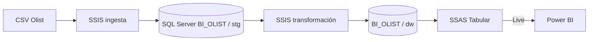

# BI-OLIST: inteligencia comercial y análisis logístico

Proyecto universitario de BI sobre el Brazilian E-Commerce Public Dataset by Olist. El flujo objetivo es CSV → SSIS → SQL Server `BI_OLIST` (`stg`, `dw`, `audit`) → SSAS Tabular → Power BI Live. Los nueve CSV se perfilaron localmente el 18-11-2026; no se versionan datos originales. Importes BRL observados no significan rentabilidad.

## Estado

- **Nivel 1:** DDL SQL de auditoría, staging, dimensiones, hechos y controles implementado y probado en SQL Server 2025 Express. Las pruebas pasaron desde base nueva y en reejecución. El dataset real no se cargó a staging/DW en esa etapa inicial. Los contratos v1, SSIS, SSAS y Power BI Live (4 páginas iniciales) conforman la línea base congelada del proyecto.
- **Nivel 2 (OLIST 360° — Business Intelligence Suite):** En fase de formalización documental (`PROPUESTA_PENDIENTE_VALIDACION`, pendiente de aprobación mediante PR). Amplía exclusivamente la capa de consumo hacia **15 páginas en Power BI Live** (8 principales, 4 tooltips y 3 drill-through) y **10 informes RDL en SSRS 2022 Developer (Native Mode)**, manteniendo intactos Data Mart, contratos v1, SSIS, SSAS Tabular y las 8 medidas DAX originales. **No está implementado ni certificado todavía.**

## Reconstrucción local

Lee [instalación local](docs/instalacion-local.md) y [guía del Data Mart](database/README.md). Perfil local: `python scripts/perfilar_dataset.py <directorio_csv>`. Validación Python: `python scripts/validar_base.py` y `python -m unittest discover -s scripts -p "test_*.py" -v`. Consulta [pruebas y evidencias](docs/pruebas-y-evidencias.md) para resultados reales y límites. Fixtures en `data/fixtures/` son sintéticas.

## Equipo

- Castilla (`mrcastilla8`): arquitectura, contratos, SQL e informe (Nivel 2: `P01`, `P08`, `R01`, `R10`, diseño y certificación).
- Poma (`GabrielPGu`): SSIS de CSV a staging (Nivel 2: infraestructura SSRS, publicación, `R07`, `R08`, apoyo `P08`).
- Cueva (`AXL031`): SSIS de staging al DW (Nivel 2: revisión SQL/granularidad, `P04`, `P05`, `T03`, `D02`, `R03`, `R05`).
- Basualdo (`MarcosBasualdoAle`): SSAS Tabular y DAX (Nivel 2: conciliación semántica sin editar `Model.bim`, `P06`, `P07`, `T04`, `D03`, `R06`, `R09`).
- Ángel (`luisdem01`): Power BI Live (Nivel 2: custodio único del PBIX maestro, tema, `P02`, `P03`, `T01`, `T02`, `D01`, `R02`, `R04`).

Los cambios se integran por PR hacia `master`; CI y resolución de conversaciones son obligatorios. No se exige aprobación externa. Ver [colaboración](docs/colaboracion.md).

## Documentación

[Contexto y alcance](docs/contexto-y-alcance.md) · [Arquitectura](docs/arquitectura.md) · [Contrato de datos](docs/contrato-datos.md) · [Métricas](docs/contrato-metricas.md) · [Plan de integración](docs/plan-integracion.md) · [Informe académico](docs/informe-academico.md) · [ADR-0001](docs/decisiones/ADR-0001-arquitectura-local.md) · [ADR-0002 (Nivel 2)](docs/decisiones/ADR-0002-nivel-2-powerbi-reporting-services.md) · [Plan Maestro Nivel 2](docs/nivel-2/00_PLAN_MAESTRO.md)
