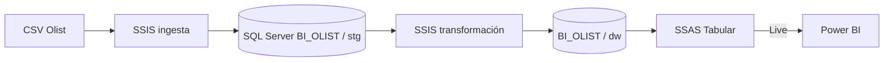

# BI-OLIST: inteligencia comercial y análisis logístico

Proyecto universitario de BI sobre el Brazilian E-Commerce Public Dataset by Olist. El flujo objetivo es CSV → SSIS → SQL Server `BI_OLIST` (`stg`, `dw`, `audit`) → SSAS Tabular → Power BI Live. Los nueve CSV se perfilaron localmente el 18-11-2026; no se versionan datos originales. Importes BRL observados no significan rentabilidad.

## Estado

DDL SQL de auditoría, staging, dimensiones, hechos y controles implementado y probado en SQL Server 2025 Express. Las pruebas pasaron desde base nueva y en reejecución. El dataset real no se cargó a staging/DW. Los contratos siguen `PROPUESTA_PENDIENTE_VALIDACION`; SSIS, SSAS, Power BI y la integración completa siguen pendientes.

## Reconstrucción local

Lee [instalación local](docs/instalacion-local.md) y [guía del Data Mart](database/README.md). Perfil local: `python scripts/perfilar_dataset.py <directorio_csv>`. Validación Python: `python scripts/validar_base.py` y `python -m unittest discover -s scripts -p "test_*.py" -v`. Consulta [pruebas y evidencias](docs/pruebas-y-evidencias.md) para resultados reales y límites. Fixtures en `data/fixtures/` son sintéticas.

## Equipo

- Castilla: arquitectura, contratos, SQL e informe.
- Poma: SSIS de CSV a staging.
- Cueva: SSIS de staging al DW.
- Basualdo: SSAS Tabular y DAX.
- Ángel: Power BI Live.

Los cambios se integran por PR hacia `master`; CI y resolución de conversaciones son obligatorios. No se exige aprobación externa. Ver [colaboración](docs/colaboracion.md).

## Documentación

[Contexto y alcance](docs/contexto-y-alcance.md) · [Arquitectura](docs/arquitectura.md) · [Contrato de datos](docs/contrato-datos.md) · [Métricas](docs/contrato-metricas.md) · [Plan de integración](docs/plan-integracion.md) · [Informe académico](docs/informe-academico.md) · [ADR-0001](docs/decisiones/ADR-0001-arquitectura-local.md)
