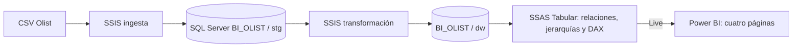

# BI-OLIST: inteligencia comercial y análisis logístico de comercio electrónico

Proyecto universitario de BI con el Brazilian E-Commerce Public Dataset by Olist. Los nueve CSV locales fueron perfilados el 18-11-2026; el resumen agregado y la herramienta reproducible están en [pruebas y evidencias](docs/pruebas-y-evidencias.md). No se suben datos originales. Nivel 1 estudia productos entregados, cumplimiento logístico, productos/vendedores y satisfacción. Importes BRL observados no equivalen a rentabilidad.

Nivel 1 comprende dataset real, staging, ETL SSIS, Data Mart dimensional, SSAS, Power BI, pruebas/evidencias e informe reproducible. DDL SQL local implementado y ejecutado en SQL Server 2025 Express; pruebas de esquema pasaron, pero ningún CSV se cargó al DW. SSIS, SSAS y Power BI aún no se integraron.

## Equipo
- Castilla [@mrcastilla8](https://github.com/mrcastilla8): arquitectura, contratos, SQL, integración e informe.
- Poma [@GabrielPGu](https://github.com/GabrielPGu): SSIS CSV a staging.
- Cueva [@AXL031](https://github.com/AXL031): SSIS staging a DW, integridad/orquestación.
- Basualdo [@MarcosBasualdoAle](https://github.com/MarcosBasualdoAle): SSAS Tabular y DAX.
- Ángel [@luisdem01](https://github.com/luisdem01): Power BI Live.

## Inicio desde cero
1. Sigue [instalación por rol](docs/instalacion-local.md) y [colaboración](docs/colaboracion.md).
2. Obtén los CSV desde una fuente autorizada y registra términos/fecha/versión. No subas ZIP ni CSV reales. Nombres esperados: `olist_orders_dataset.csv`, `olist_order_items_dataset.csv`, `olist_order_payments_dataset.csv`, `olist_order_reviews_dataset.csv`, `olist_customers_dataset.csv`, `olist_sellers_dataset.csv`, `olist_products_dataset.csv`, `olist_geolocation_dataset.csv`, `product_category_name_translation.csv`.
3. Lee [arquitectura](docs/arquitectura.md), [contrato de datos](docs/contrato-datos.md), [métricas](docs/contrato-metricas.md) y tu issue.
4. Trabaja en tu rama estable desde `master`, crea PR con evidencia.
5. Valida con `python scripts/validar_base.py`.

Fixtures en `data/fixtures/` son sintéticas. Los contratos siguen provisionales hasta validar técnicamente las reglas y coordinar consumidores. CI valida contratos, docs, fixtures y privacidad; las pruebas locales SQL no acreditan SSIS/SSAS/Power BI. Capturas integradas y resultados analíticos pendientes.

## Guías
[Contexto](docs/contexto-y-alcance.md) · [plan de integración](docs/plan-integracion.md) · [pruebas/evidencias](docs/pruebas-y-evidencias.md) · [informe](docs/informe-academico.md) · [roadmap](docs/roadmap.md) · [ADR-0001](docs/decisiones/ADR-0001-arquitectura-local.md)

Componentes: [SQL](database/README.md), [SSIS ingesta](ssis/ingesta/README.md), [SSIS transformación](ssis/transformaciones/README.md), [SSAS](ssas/README.md), [Power BI](powerbi/README.md).
# BI-OLIST Nivel 1

Arquitectura: CSV Olist → SSIS → SQL Server `BI_OLIST` (`stg`, `dw`, `audit`) → SSAS Tabular → Power BI Live. El Data Mart usa los contratos v1 con estado `PROPUESTA_PENDIENTE_VALIDACION` hasta aprobación técnica trazable. Revisa [arquitectura](docs/arquitectura.md), [contratos](docs/contrato-datos.md) y [manual SQL](database/README.md).

Para crear/probar el esquema local en Windows sigue [database/README.md](database/README.md). Los nueve CSV reales se mantienen solo localmente; el perfil se repite con `python scripts/perfilar_dataset.py <carpeta_csv>`. CI valida documentación/fixtures Python y no prueba SSIS, SSAS ni Power BI.
