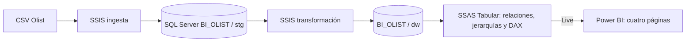

# BI-OLIST: inteligencia comercial y análisis logístico de comercio electrónico

Proyecto universitario de BI con el Brazilian E-Commerce Public Dataset by Olist (órdenes históricas de Brasil, aprox. 2016–2018; cobertura exacta por inspeccionar). Nivel 1 estudia productos entregados, cumplimiento logístico, productos/vendedores y satisfacción. Importes observados en BRL no equivalen a rentabilidad.

Nivel 1 comprende dataset real, staging, ETL SSIS, Data Mart dimensional, SSAS, Power BI, pruebas/evidencias e informe reproducible. Estado honesto: solo bootstrap documental/contratos; no se han integrado datos reales ni implementado/probado SSIS, SQL DW, SSAS o Power BI.

## Equipo
- Castilla [@mrcastilla8](https://github.com/mrcastilla8): arquitectura, contratos, SQL, integración e informe.
- Poma [@GabrielPGu](https://github.com/GabrielPGu): SSIS CSV a staging.
- Cueva [@AXL031](https://github.com/AXL031): SSIS staging a DW, integridad/orquestación.
- Basualdo [@MarcosBasualdoAle](https://github.com/MarcosBasualdoAle): SSAS Tabular y DAX.
- Ángel [@luisdem01](https://github.com/luisdem01): Power BI Live.

## Inicio desde cero
1. Sigue [instalación por rol](docs/instalacion-local.md) y [colaboración](docs/colaboracion.md).
2. Descarga manualmente el [dataset Kaggle](https://www.kaggle.com/datasets/olistbr/brazilian-ecommerce), revisa/acepta sus condiciones y registra versión y fecha. No subas ZIP ni CSV reales. Archivos previstos (nombres oficiales): `olist_orders_dataset.csv`, `olist_order_items_dataset.csv`, `olist_order_payments_dataset.csv`, `olist_order_reviews_dataset.csv`, `olist_customers_dataset.csv`, `olist_sellers_dataset.csv`, `olist_products_dataset.csv`, `olist_geolocation_dataset.csv`, `product_category_name_translation.csv`.
3. Lee [arquitectura](docs/arquitectura.md), [contrato de datos](docs/contrato-datos.md), [métricas](docs/contrato-metricas.md) y tu issue.
4. Trabaja en tu rama estable desde `master`, crea PR con evidencia.
5. Valida con `python scripts/validar_base.py`.

Fixtures en `data/fixtures/` cubren estructuralmente nueve fuentes y son sintéticas, no perfilan Olist ni prueban ETL. Los tipos/campos siguen pendientes de cotejo con CSV auténticos. CI valida contratos, docs, fixtures y privacidad; no ejecuta SSIS/SQL Server/SSAS/Power BI. Capturas y resultados reales pendientes.

## Guías
[Contexto](docs/contexto-y-alcance.md) · [plan de integración](docs/plan-integracion.md) · [pruebas/evidencias](docs/pruebas-y-evidencias.md) · [informe](docs/informe-academico.md) · [roadmap](docs/roadmap.md) · [ADR-0001](docs/decisiones/ADR-0001-arquitectura-local.md)

Componentes: [SQL](database/README.md), [SSIS ingesta](ssis/ingesta/README.md), [SSIS transformación](ssis/transformaciones/README.md), [SSAS](ssas/README.md), [Power BI](powerbi/README.md).
