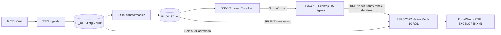

# ADR-0002: Ampliación Nivel 2 — Power BI Live rediseñado y Microsoft SQL Server Reporting Services (OLIST 360°)

- **Estado:** `ACEPTADO` (aprobación arquitectónica y documental; entra en vigor tras el merge del PR `#14`).
- **Fecha de creación:** 2026-11-26.
- **Fecha efectiva de aprobación:** 2026-11-26.
- **Aprobador:** `mrcastilla8` (líder del proyecto).
- **PR de formalización:** `#14` (`castilla/nivel-2-plan` → `master`).
- **Alcance relacionado:** `docs/nivel-2/` (16 documentos de especificación y guías individuales).

## 1. Motivación académica y empresarial

Tras completar la línea base del Nivel 1, el docente solicitó mejorar sustancialmente el reporte existente en Power BI (cuyas capturas `REP-02` a `REP-05` evidenciaron diseño predeterminado, etiquetas técnicas, filtros de gran tamaño y baja jerarquía visual) e incorporar **Microsoft SQL Server Reporting Services (SSRS)** para responder a necesidades operativas de informes paginados, parametrizados y exportables.

Para atender ambos requerimientos de manera estructurada sin comprometer la estabilidad del núcleo analítico ya construido, se diseñó el Nivel 2 bajo el nombre **OLIST 360° — Business Intelligence Suite**, orientado a decisiones ejecutivas y comerciales en Power BI e investigación detallada y distribución imprimible en SSRS.

## 2. Arquitectura propuesta

Se extiende [ADR-0001](ADR-0001-arquitectura-local.md) **exclusivamente en la capa de consumo**, manteniendo intacto el flujo de ingesta, almacenamiento y modelado semántico:

- **Power BI Desktop (Live):** evolución del reporte existente hacia **15 páginas totales** (8 páginas principales `P01`–`P08`, 4 páginas auxiliares de tooltip `T01`–`T04` y 3 páginas auxiliares de drill-through `D01`–`D03`), con identidad visual unificada (`olist360.json`) y navegación hacia el portal SSRS.
- **SSRS 2022 Developer (Native Mode):** **10 informes paginados RDL** (`R01`–`R10`) organizados en `/OLIST360` (`01_Gerencia`, `02_Comercial`, `03_Operaciones`, `04_Auditoria`), con exportación verificable a PDF y Excel (`EXCELOPENXML`).

## 3. Decisiones clave y restricciones de inmutabilidad

1. **Selección de SSRS 2022 Developer (Native Mode):** se selecciona SSRS 2022 Developer con catálogo interno (`ReportServer` y `ReportServerTempDB`) alojado en la instancia local existente de SQL Server 2025 Developer. Esta selección queda **sujeta a validación efectiva del entorno** en la puerta `G0` (edición exacta, compatibilidad de catálogo, servicio web, portal web y Report Builder / extensión compatible).
2. **Conservación de Power BI Live sobre SSAS:** conexión Live obligatoria a `BI_OLIST_Tabular`. Queda prohibido cambiar a modo Import, crear modelos compuestos, tablas locales, columnas calculadas o visual calculations.
3. **Inmutabilidad de las ocho medidas DAX:** `ssas/BI_OLIST_Tabular/Model.bim` permanece congelado. Se prohíbe agregar, eliminar o modificar cualquiera de las ocho medidas DAX originales, así como crear medidas locales en Power BI.
4. **Conservación del modelo dimensional y procesos SSIS:** permanecen intactos `database/`, `contracts/`, `ssis/` y `ssas/`. No se crean vistas, procedimientos almacenados, índices ni tablas nuevas en `BI_OLIST`.
5. **Incorporación de SSRS mediante consultas SQL de solo lectura:** los 10 RDL consumen `BI_OLIST.dw` (y `audit.Batch`/`audit.Reject` únicamente de forma agregada en `R10`) mediante consultas `SELECT`/CTE parametrizadas, usando un origen compartido con identidad dedicada de lectura (sin permisos DML ni privilegios `sysadmin`/`db_owner`). En `R10` se prohíbe exponer `error_message`, `source_file`, `execution_context` o registros individuales de `audit.Reject`.
6. **Integración Power BI ↔ SSRS:** se realiza mediante enlaces URL fijos desde `P01`–`P08` hacia el portal SSRS y parametrización explícita dentro del propio portal SSRS. No se promete transferencia automática de filtros desde Power BI hacia SSRS. El drill-through entre informes (`R05` → `R08` y acciones definidas) se ejecuta dentro de SSRS con parámetros explícitos.
7. **Custodia única del PBIX maestro:** durante la integración, **Ángel** es el único escritor autorizado de `powerbi/BI_OLIST.pbix` para evitar conflictos binarios; los demás integrantes entregan avances individuales para integración controlada.

## 4. Alternativas descartadas

- **Power BI Report Server (PBIRS):** descartado por no ser requerido por el docente; solo se reevaluaría con autorización académica explícita.
- **Power BI Service / infraestructura cloud (Azure):** descartado por alcance académico local y restricción de no depender de cuentas de pago ni servicios en la nube.
- **Modificar `Model.bim` o agregar medidas DAX:** descartado para preservar la integridad semántica y el contrato v1 certificado en Nivel 1.
- **Replicar datos en Power BI (modo Import) o alterar tablas DW para informes:** descartado para mantener una única fuente de verdad y evitar divergencias entre Power BI y SSRS.

## 5. Consecuencias técnicas

- Requiere disponer en Windows de una instancia local funcional de SSRS 2022 Developer Native Mode y Report Builder (además de SQL Server 2025 Developer, SSAS Tabular y Power BI Desktop).
- Exige separar la autenticación Windows de usuarios en el portal SSRS (rol `Browser` para lectura vs. administrador de publicación) de la identidad de lectura dedicada del origen compartido hacia `BI_OLIST`.
- Impone disciplina de integración secuencial para el archivo binario `powerbi/BI_OLIST.pbix` bajo custodia exclusiva de Ángel, y validación cruzada de conciliación numérica entre SQL, SSAS, Power BI y SSRS.
- **Reversión:** en caso de requerirse reversión, basta restaurar el `powerbi/BI_OLIST.pbix` previo y retirar los artefactos del proyecto SSRS sin afectar el Data Mart, SSIS ni SSAS.

## 6. Riesgos y mecanismos de validación

| Riesgo | Mecanismo de validación / mitigación |
|---|---|
| Incompatibilidad práctica de SSRS 2022 con la instancia local de SQL Server 2025 Developer o extensión de Visual Studio | Preflight obligatorio en puerta `G0` (`SELECT @@VERSION`, creación de catálogo vía Configuration Manager y ruta aprobada con Report Builder). |
| Incompatibilidad de Shape Map (`P07`) con conexión Live o versión de Power BI Desktop | Validación temprana de TopoJSON (27 UF con claves exactas) en `PBI-08`; si falla, registrar `BLOCKED_MAP` sin declarar aceptación cartográfica. |
| Desalineación semántica entre cálculos SQL en RDL y medidas DAX en SSAS | Conciliación sistemática contra `Comparar-Metricas.ps1` y pruebas de certificación (`docs/nivel-2/08_PRUEBAS_CERTIFICACION.md`, incluyendo 8 métricas y escenarios sin datos / `NULL`). |
| Problemas de autenticación Windows o doble salto en portal SSRS | Prueba de acceso con rol `Browser` y rechazo de usuario no autorizado (`SSRS-02`), usando loopback local autorizado. |
| Regresiones sobre componentes congelados | Verificación de integridad SHA-256 y `git diff` contra `origin/master` en `database/`, `contracts/`, `ssis/` y `ssas/`, más `validar_base.py` y `unittest` (`BASE-01`, `BASE-02`). |

## 7. Estado de aprobación

Este documento se encuentra en estado **`ACEPTADO`** como definición arquitectónica y documental del Nivel 2:

- **Aprobador:** `mrcastilla8` (líder del proyecto).
- **Fecha efectiva de aprobación:** 2026-11-26.
- **PR de formalización:** `#14` (`castilla/nivel-2-plan` → `master`).
- **Entrada en vigor:** efectiva tras el merge del PR `#14` hacia `master`, momento a partir del cual se habilita la creación de issues/ramas individuales y la ejecución de las puertas `G0` y `G1` descritas en [00_PLAN_MAESTRO.md](../nivel-2/00_PLAN_MAESTRO.md).
- **Alcance y límites:** esta aprobación es exclusivamente **arquitectónica y documental**. La **implementación y certificación práctica del Nivel 2 permanecen pendientes** (los 29 casos de certificación en `08_PRUEBAS_CERTIFICACION.md` continúan en estado `NOT_RUN`), y la **compatibilidad práctica de SSRS 2022 con SQL Server 2025 Developer y de Shape Map en conexión Live** queda sujeta a validación real en Windows durante `G0` y `PBI-08`.
