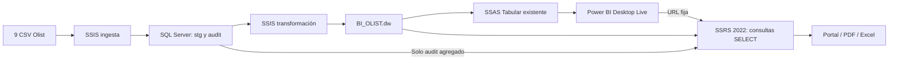

# 01 — Arquitectura y ADR de ampliación

**BI-OLIST Nivel 2 · 26/11/2026 · Especificación de implementación (no evidencia de ejecución)**

## Arquitectura objetivo

Los consumidores leen la misma publicación del DW. Detener cargas durante certificación, registrar huellas/conteos y procesar SSAS tras la carga. No exponer servicios a internet. SSRS usa catálogo interno separado `ReportServer`/`ReportServerTempDB` (o nombres locales configurados), no el esquema DW. El portal autentica usuarios Windows, y el origen compartido usa una identidad de lectura dedicada; no confundir las dos identidades.

## Inventario real
- `dw.DimFecha`: fecha, anio, trimestre, mes, nombre_mes, dia, dia_semana; `fecha_key=-1` desconocida.
- `dw.DimCliente`: `customer_unique_id`; `DimProducto`: `product_id`, categorías inglés/portugués, atributos físicos; `DimVendedor`: `seller_id`.
- `DimGeografiaCliente`: `customer_state/customer_city`; `DimGeografiaVendedor`: `seller_state/seller_city`.
- `FactPedidos`: una fila por `order_id`, compra, estado, fechas estimada/real, `payment_value_total`, `review_score` consolidada.
- `FactDetallePedido`: una fila por `(order_id, order_item_id)`, `price`, `freight_value`, estado y claves de dimensiones.
- `audit.Batch`, `audit.Reject`: historial de lotes y rechazos. No leer `stg` para informes.

## Matriz semántica
| Medida | Hecho | Fecha compra, cliente, región cliente | Producto, vendedor, región vendedor |
|---|---|---|---|
| ventas_productos_entregados | Detalle | Sí | Sí |
| pedidos_entregados_con_items | Detalle | Sí | Sí |
| ticket_promedio_productos_entregados | Detalle | Sí | Sí |
| flete_pedidos_entregados | Detalle | Sí | Sí |
| pedidos_totales | Pedidos | Sí | No |
| porcentaje_entregas_a_tiempo | Pedidos | Sí | No |
| dias_promedio_entrega | Pedidos | Sí | No |
| calificacion_promedio | Pedidos | Sí | No |
Estado del pedido existe en ambos hechos: `FactPedidos.order_status` solo filtra medidas de cabecera; `FactDetallePedido.order_status` solo las de detalle. Las relaciones de fechas real/estimada están inactivas en SSAS, por eso la fecha de análisis PBI es compra. No activar ni modificar relaciones. `review_score`, precio y fechas operativas están ocultos en modelo; no depender de ellos en PBI. Los pedidos distintos no son aditivos entre categorías/vendedores; recalcular totales al grano correcto. Las notas no se ponderan por líneas.

## ADR-0002 — referencia de decisión aprobada
**Estado:** `ACEPTADO` por `mrcastilla8` el 2026-11-26 en el PR `#14` (alcance arquitectónico y documental; entrada en vigor tras el merge; implementación y certificación práctica pendientes). **Decisión:** extender ADR-0001 exclusivamente en la capa de consumo con Power BI Live rediseñado y SSRS 2022 Native Mode. Mantener contratos y componentes de datos congelados. SQL de informes en carpeta `reporting-services/`, SELECT con parámetros, origen de lectura; auditoría exclusivamente agregada. La navegación PBI→SSRS usa enlaces fijos; la selección de filtros es independiente. **Alternativas descartadas:** PBIRS (no requerido; reevaluar solo si docente lo autoriza), Power BI Service, cambiar DAX, replicar datos. **Consecuencias:** servidor Windows adicional, portal autenticado y pruebas de conciliación y exportación. **Reversión:** restaurar PBIX previo y retirar únicamente el proyecto/portal Nivel 2 sin alterar DW, SSIS o SSAS.

## Formalización normativa realizada en el PR #14
La formalización documental quedó registrada en [ADR-0002-nivel-2-powerbi-reporting-services.md](../decisiones/ADR-0002-nivel-2-powerbi-reporting-services.md), junto con la actualización de `AGENTS.md`, `README.md`, `docs/contexto-y-alcance.md`, `docs/arquitectura.md`, `docs/instalacion-local.md`, `docs/roadmap.md`, `docs/plan-integracion.md`, `docs/pruebas-y-evidencias.md`, `docs/README.md`, `powerbi/AGENTS.md` y `powerbi/README.md`, y la creación de `reporting-services/AGENTS.md`. Se conserva íntegra la evidencia histórica del Nivel 1, distinguiéndola de la implementación aún pendiente del Nivel 2.

## Referencias verificadas
- Microsoft: [consolidación de Reporting Services y soporte SSRS 2022](https://learn.microsoft.com/en-us/sql/reporting-services/reporting-services-consolidation-faq?view=sql-server-ver16).
- Microsoft: [versiones del motor para catálogo](https://learn.microsoft.com/en-us/sql/reporting-services/install-windows/ssrs-report-server-create-a-report-server-database?view=sql-server-ver17). SQL Server 2025 está listado; validar edición, versión y ejecución efectiva en G0.
