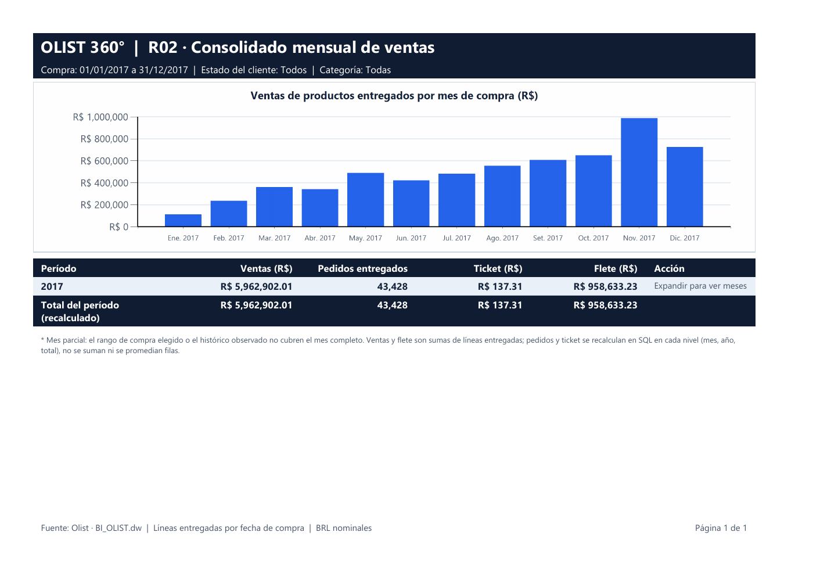
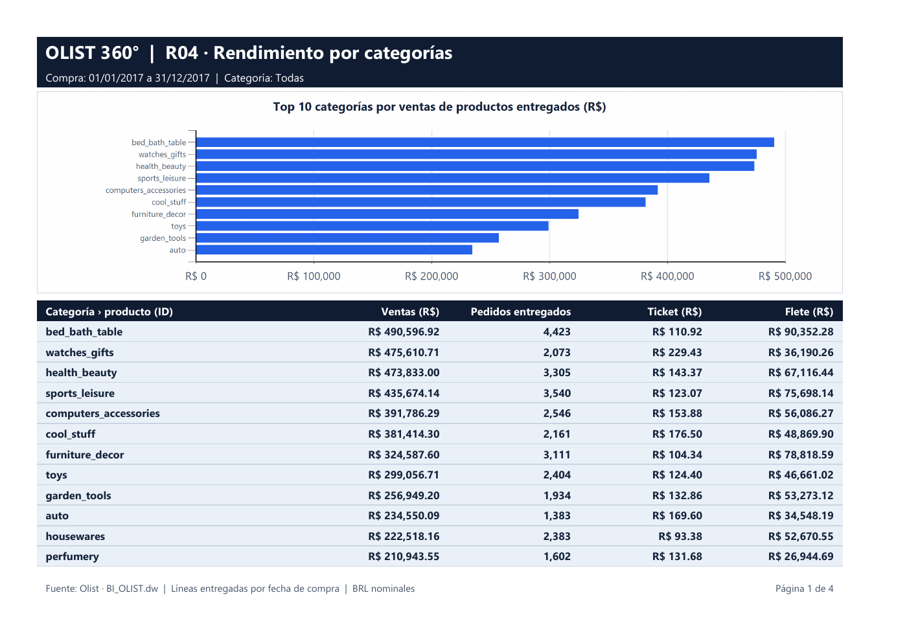
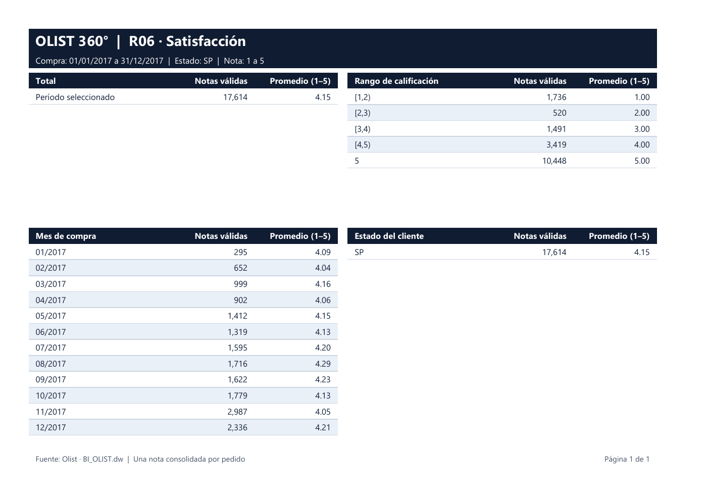
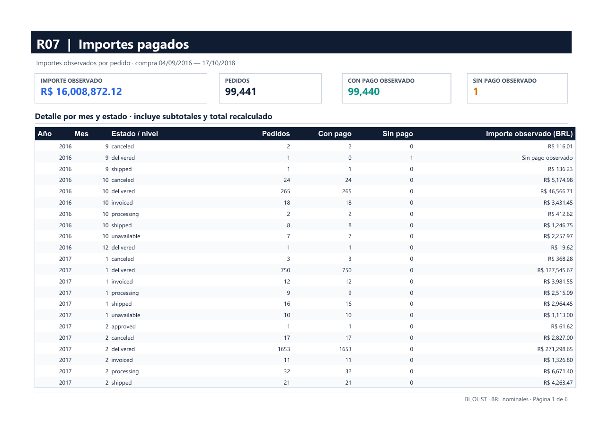
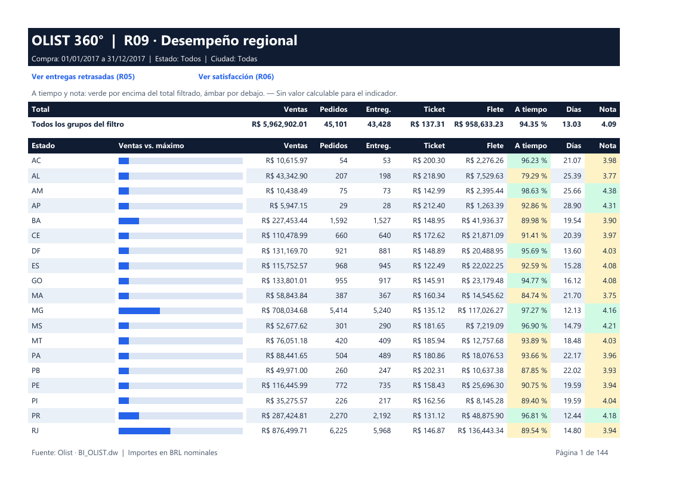
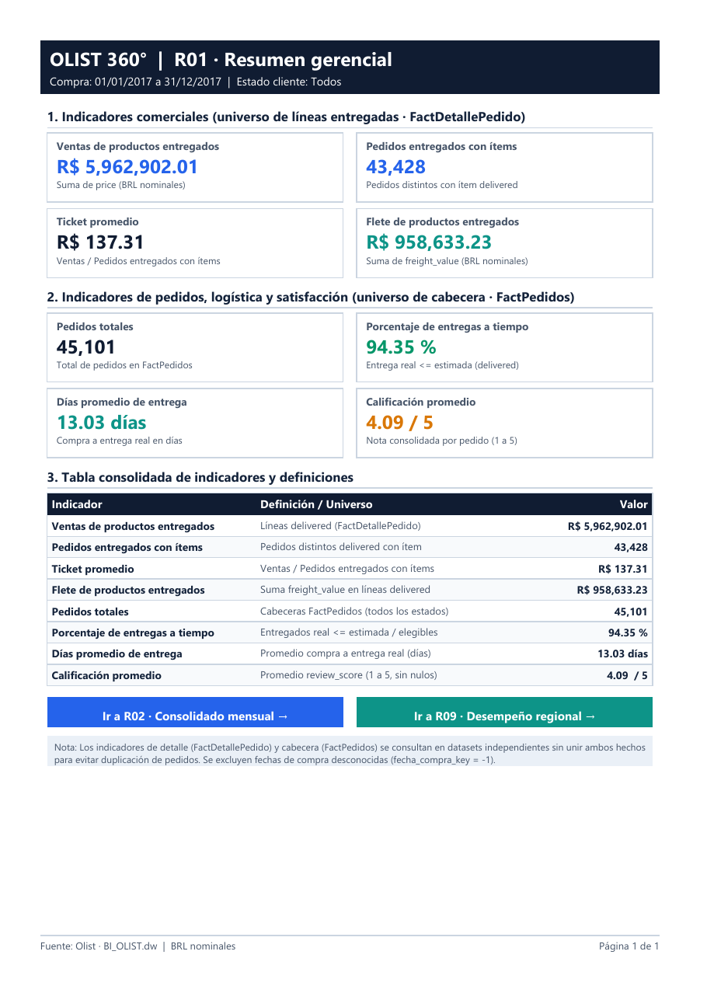
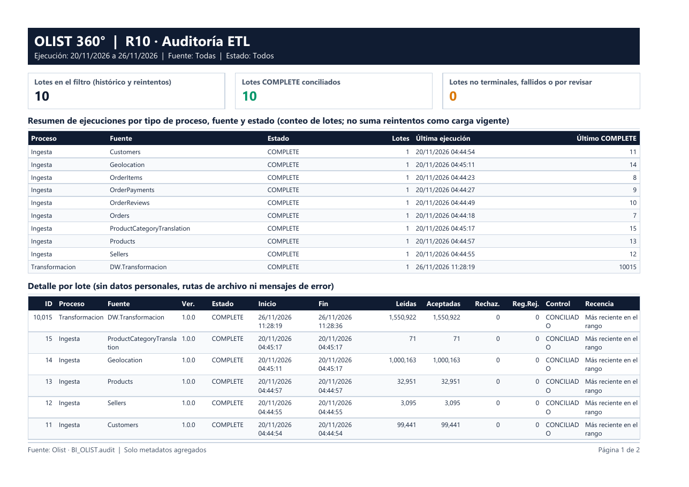

# M06–M07 — integración y exportaciones SSRS (corte parcial)

> **Corte histórico:** las secciones siguientes registran la ejecución anterior de seis informes. El cierre integral de diez informes del 2026-11-27 está añadido al final; sus resultados sustituyen el estado parcial sin borrar esta trazabilidad.

**Fecha de ejecución:** 2026-11-27 · **Rama:** `poma/nivel-2-reporting` · **HEAD de los RDL probados:** `e15fede1928518f096cd8e2b0edcd456af9cf41c` · **Entorno:** Windows 11 Home 25H2, SQL Server Developer `17.0.1000.7`, SSRS Developer Native Mode `16.0.1122.6`, Report Builder `15.1.30001.02`.

Este corte registra seis de los diez informes publicados en el SSRS local: R02, R04, R06, R07, R08 y R09. La rama local parte del mismo commit que `master` remoto al momento de la prueba. Los cuatro RDL de Ángel y Basualdo estaban ya en ese commit; no se modificaron para esta integración.

## Servicio y origen usados

- Portal local: `http://localhost/Reports`.
- Servicio de informes: `http://localhost/ReportServer`.
- Origen compartido: `/OLIST360/DataSources/BI_OLIST_DW`, conectado a `BI_OLIST` con autenticación integrada.
- Las seis rutas publicadas aparecen en el índice de evidencias. Las ejecuciones y exportaciones consultaron el Data Mart real; no se ejecutó DDL ni DML.

Usar `localhost` para la sesión Windows local. `127.0.0.1` había abierto un diálogo de autenticación en Brave.

## Ejecución de informes y parámetros

| Informe / ruta | Parámetros ejecutados | Resultado observado |
|---|---|---|
| R02 — `/OLIST360/01_Gerencia/R02_ConsolidadoMensual` | 01/01/2017–31/12/2017; todos los estados de cliente; todas las categorías | 12 meses; ventas **R$ 5.962.902,01**; **43.428** pedidos entregados; ticket **R$ 137,31**; flete **R$ 958.633,23**. PDF de 1 página; XLSX abierto en Excel. |
| R04 — `/OLIST360/02_Comercial/R04_RendimientoCategorias` | 01/01/2017–31/12/2017; todas las categorías | La primera categoría fue `bed_bath_table`, con ventas de **R$ 490.596,92** y **4.423** pedidos entregados. PDF de 4 páginas; XLSX abierto en Excel. |
| R06 — `/OLIST360/03_Operaciones/R06_Satisfaccion` | 01/01/2017–31/12/2017; estado `SP`; nota de 1 a 5 | **17.614** notas válidas; promedio mostrado **4,15**. PDF de 1 página; XLSX abierto en Excel. |
| R07 — `/OLIST360/02_Comercial/R07_ImportesPagados` | 04/09/2016–17/10/2018; todos los estados | **162** agregados; **99.441** pedidos; **99.440** con pago observado y **1** sin pago observado; total observado **R$ 16.008.872,12**. PDF de 6 páginas; XLSX abierto en Excel. |
| R08 — `/OLIST360/03_Operaciones/R08_FichaPedido` | Identificador de un pedido existente, conservado solo localmente | Se comprobó cabecera, dos líneas y pago agregado; también se ejecutó un identificador inexistente y las consultas devolvieron cero cabeceras y cero líneas. PDF de 1 página y XLSX generados y revisados localmente. El identificador y las exportaciones de detalle no se incluyen en Git. |
| R09 — `/OLIST360/03_Operaciones/R09_DesempenoRegional` | 01/01/2017–31/12/2017; estado `SP`; ciudad `sao paulo` | **6.381** pedidos, **6.123** entregados, ventas **R$ 752.425,64**, flete **R$ 100.270,40**, puntualidad **95,93 %**, entrega media **8,64 días** y nota **4,12**. PDF de 1 página; XLSX abierto en Excel. |

Los parámetros descritos son los seleccionados durante cada ejecución. No se cambió ningún RDL ni contrato.

## Revisión de exportaciones

Se generaron los seis pares PDF/XLSX desde SSRS. Los seis XLSX se abrieron y mostraron contenido en Excel. Los seis PDF se renderizaron localmente con Poppler y se revisó su salida visual; las vistas PNG de la página 1 de R02, R04, R06, R07 y R09 se incluyen en `evidencias/renderizados-2026-11-27/`. La vista de R08 y sus archivos de exportación quedan en `validacion/salidas/`, ignorada por Git, porque contienen datos de un pedido individual.

Excel mostró la advertencia de activación de producto en el título de la ventana, pero permitió abrir y leer los seis libros. En R09, el indicador gráfico “Ventas vs. máximo” sale como barras verticales repetidas en el PDF; las métricas tabulares se leen y coinciden con la ejecución. Es una limitación visual que queda registrada.

### SHA-256 de los RDL fuente probados

Estos hashes identifican la copia versionada en el HEAD de la prueba; no afirman una comparación binaria con los elementos almacenados internamente en el catálogo SSRS.

| RDL | SHA-256 |
|---|---|
| `R02_ConsolidadoMensual.rdl` | `4E2A95030D5CDFAD596410949AF91304A9E2A1CC46AE19828C8535C8448A435E` |
| `R04_RendimientoCategorias.rdl` | `1BD3476A3F2BE11994E6470EA7752BE6A331A9F87707DF0C61228493785EC767` |
| `R06_Satisfaccion.rdl` | `A6191E718DE9B4BEC046F9C2872B4FB50023F885BA8CAACC4D1F59B21BB06600` |
| `R07_ImportesPagados.rdl` | `D6F309E3E75345A1E8A0DE74FF0DF22D5E3837F18A3A28E4A142EBF1E8052EA9` |
| `R08_FichaPedido.rdl` | `05923CE1C31A68C214F3FFE817AB0EF48C92BB5764E3AF229496AE1E0210B68D` |
| `R09_DesempenoRegional.rdl` | `7EE2A679FC6AA2A7F4B1AFCFC9A8E3396EDAFCBD36B217EEEDC8C754DB88653A` |

### SHA-256 de exportaciones agregadas

Los cinco informes listados no contienen identificadores de pedidos individuales. R08 se excluye de esta tabla por la política de datos; sus archivos y captura se mantienen localmente en la carpeta ignorada.

| Informe | PDF (bytes) | SHA-256 PDF | XLSX (bytes) | SHA-256 XLSX |
|---|---:|---|---:|---|
| R02 | 226720 | `D26759D0B0FC9644FACFD3F59BC935913DD2B85EB84F0C4584A8667CD65FD4A3` | 20221 | `0EB5FA7B8FA25950AB2A82B587B2703EA8C0285870D0DCABA380C33D22F06818` |
| R04 | 237965 | `6740C0A1C8C494C6E53A6D030BCE02BC79C2472CD617C83B0B657B3484FAEDDD` | 859142 | `1F475A5A0B703F8771EA78EABC168A93D1674BA1617CD3373E6F8BB7D2D45ADE` |
| R06 | 187350 | `9C2FB70778990A47F34F4EF2A945A6274B25BC673968137E452492710E1796D5` | 6212 | `941635DE7CBC542C0F90DC2807E7BE6CB63AA68D4AAF8664F4336A7A181A12A8` |
| R07 | 276611 | `08FE02151B40A3445D0E00A020AA170A49AF6FCFC2AB3B9CE9FE054107D5C2C1` | 22290 | `4804C66E6110F8FE5285E9049B75DDF2441A2FC575116508638B7FF54B1FA09A` |
| R09 | 194560 | `BE8519AA96468E8F201827F04639943F59BA16FA653394A871174285A067C143` | 6984 | `6FCB741252065B4186EAC65EB45BB6F363CA9225B002E73109F8640284FF0ED8` |

## Vistas verificadas

Las imágenes son la página inicial de la exportación PDF real, no una captura simulada. La imagen de R08 permanece local por la misma regla de privacidad.

| Informe | Vista |
|---|---|
| R02 |  |
| R04 |  |
| R06 |  |
| R07 |  |
| R08 | Inspección local: `validacion/salidas/R08-SSRS-1.png`; excluida del commit por contener detalle del pedido. |
| R09 |  |

## Validaciones, resultado y pendientes

- `python scripts/validar_base.py`: **PASS** el 2026-11-27.
- `reporting-services/scripts/Verificar-CatalogoSSRS.ps1 -SqlServerInstance localhost -PortalUrl http://localhost/Reports -ReportServerUrl http://localhost/ReportServer -TrustServerCertificate`: **PASS**; portal y SOAP HTTP 200, ambos catálogos ONLINE y servicio SSRS `Running`. La primera ejecución dentro del sandbox fue bloqueada por acceso a socket/CIM; el mismo chequeo de solo lectura se repitió con permiso local y terminó PASS.
- `reporting-services/scripts/Validar-Scripts.ps1`: **PASS**; siete scripts PowerShell parsean sin errores.
- `git diff --check`: **PASS** tras actualizar esta evidencia.
- La verificación de SSRS local y la ejecución de los seis RDL se hicieron en Windows contra el servicio local y `BI_OLIST`. No se hicieron cambios de DDL/DML.
- R02, R04, R06, R07, R08 y R09: **6/10** publicados y ejecutados.
- R01, R03, R05 y R10 siguen pendientes de publicación/prueba. Por eso los criterios globales M06 y M07 y las evidencias oficiales EVD-SSRS-06, EVD-SSRS-07 y EVD-SSRS-08 permanecen **PARCIAL (6/10)**.
- La prueba visual de exportaciones del informe de humo PRE_G0_Humo continúa pendiente; su caso `PRE-G0-07` no se cambia a PASS por esta revisión.
- No se modificaron `database/`, `contracts/`, `ssis/`, `ssas/`, DAX ni el PBIX maestro. No se creó ningún issue y no se hizo merge.

## Cierre integral M06–M07 — 2026-11-27

**HEAD de las ejecuciones:** `97fca9aaa073958b9ffb31101a7862133271cd01` (`97fca9a`). Las exportaciones se ejecutaron en Windows contra `http://localhost/ReportServer`, con el origen compartido `/OLIST360/DataSources/BI_OLIST_DW` y valores de parámetros redaccionados. `ReportService2010.ListChildren('/OLIST360', true)` devolvió diez informes y confirmó que el informe de humo ya no está en el catálogo.

| Informe | Parámetros ejecutados | Resultado real | PDF |
|---|---|---|---:|
| R01 — Resumen gerencial | 01/01/2017–31/12/2017; todos los estados de cliente | Ocho KPI y acciones de navegación renderizados; destino probado con R02 y R09 | 1 pág. |
| R02 — Consolidado mensual | 01/01/2017–31/12/2017; todos los estados y categorías | 12 meses; ventas **R$ 5.962.902,01**, **43.428** pedidos entregados, ticket **R$ 137,31** y flete **R$ 958.633,23** | 1 pág. |
| R03 — Ranking de vendedores | 01/01/2017–31/12/2017; todos los estados de vendedor; `TopN=10` | Ejecución real del ranking Top 10 sin error de render | 1 pág. |
| R04 — Rendimiento por categorías | 01/01/2017–31/12/2017; todas las categorías | `bed_bath_table` lideró con **R$ 490.596,92** y **4.423** pedidos entregados | 4 págs. |
| R05 — Entregas retrasadas | 01/01/2017–31/12/2017; estado `SP`; retraso mínimo 1 día | Ejecución real con el filtro documentado; 44 páginas. El acceso histórico desde el portal mostró 6.534 filas en su configuración histórica por defecto, en 298 páginas | 44 págs. |
| R06 — Satisfacción | 01/01/2017–31/12/2017; estado `SP`; notas 1–5 | **17.614** reseñas válidas; promedio **4,15** | 1 pág. |
| R07 — Importes pagados | 04/09/2016–17/10/2018; todos los estados | **162** agregados; **99.441** pedidos, **99.440** con pago observado y **1** sin pago; total **R$ 16.008.872,12** | 6 págs. |
| R08 — Ficha de pedido | Pedido de varias líneas elegido localmente; el valor de `OrderId` no se guarda | 1 cabecera, 2 líneas y pago agregado; también se comprobaron ID inexistente y pedido sin líneas | 1 pág. |
| R09 — Desempeño regional | 01/01/2017–31/12/2017; estado `SP`; ciudad `sao paulo` | **6.381** pedidos, **6.123** entregados, ventas **R$ 752.425,64**, flete **R$ 100.270,40**, puntualidad **95,93 %**, entrega media **8,64 días**, nota **4,12** | 1 pág. |
| R10 — Auditoría ETL | 20/11/2026–26/11/2026; todas las fuentes y estados | **10** lotes en el filtro, **10 COMPLETE** conciliados y **0** fallidos/no terminales | 2 págs. |

Se generaron diez PDF y diez XLSX (HTTP 200, tipos y firmas comprobados). Se renderizaron y revisaron las **62 páginas PDF**; los diez libros se abrieron en Excel. Excel mostró una advertencia de activación del producto, pero permitió visualizar los libros. No se detectaron páginas PDF en blanco ni recortes en los informes; el segundo folio del humo se corrigió antes de volverlo a publicar y exportar.

R09 conserva un defecto visual: el gráfico “Ventas vs. máximo” aparece como glifos verticales repetidos. Sus cifras tabulares se leen y el informe se ejecuta; la corrección corresponde al autor Basualdo y no se aplicó en este alcance.

### SHA-256 del RDL y de las exportaciones actuales

Los archivos de exportación se guardan en la carpeta local ignorada `validacion/salidas/cierre-poma-2026-11-27/`. R08 se deja fuera de los hashes de exportación versionados porque sus archivos contienen detalle de un pedido individual; su RDL fuente sí se identifica aquí.

| Informe | SHA-256 RDL | PDF (bytes / SHA-256) | XLSX (bytes / SHA-256) |
|---|---|---|---|
| R01 | `D23E18A6031A6434E7A4F7922859147B8EBB66885F72C0CDBE30EA52EAF6A3B7` | 195669 / `530F8524117A3F15C3ABCDA5B2760FB3517198F1573FB4971C037C6E00227431` | 8337 / `2EB75D21FAABDC7DC89C44E5FE015C314930BA70DF614FAF1658982B0B111F48` |
| R02 | `4E2A95030D5CDFAD596410949AF91304A9E2A1CC46AE19828C8535C8448A435E` | 226724 / `CC994A09EEEE9C457B856C4D36F0884C6ED6E662F45F010CF4CB348A29469989` | 20221 / `B3F3BE5D1E18A0073CFD069A39929525C0B61C538B28532A8F52C5944A01EC1E` |
| R03 | `5B3A964563D0C2130CFED3DED0B263FB518974108B90D1E546A08989AFC6D9CA` | 184148 / `8ACDFD4C00AE1348603CADF0E6E4DC729204519356EDEEEA3120C61BE0A8F116` | 6249 / `29FA66C7E9118098C5BD2697D4CC54EA34016C5C3F2D65D8220944823FF65146` |
| R04 | `1BD3476A3F2BE11994E6470EA7752BE6A331A9F87707DF0C61228493785EC767` | 237965 / `87C123149B95998D82C7E9DD7D7818F7D68650DF3065D83E16161CFE817F2702` | 859142 / `FC77479B87CF4690E757955E20E35C7DD3D18EE50A6268B20F6631B6917347B6` |
| R05 | `4366CEFDF400737DC115C9C05065AB7A81AC577071171A481A6ADEE731C4D15E` | 366286 / `00F6F77BD2DC03D62E0912F3C0DD1D259C51F87065F5766E922333E9B3D80695` | 72696 / `AD6C1D04F5730325E100AF8C49BEBAD30D76DC5EBEDE8A81412BF7A12994D291` |
| R06 | `A6191E718DE9B4BEC046F9C2872B4FB50023F885BA8CAACC4D1F59B21BB06600` | 187350 / `4192D7212690D8FD89CACE63BC31C4871DC6DC6495FAACA36A5AA89B5C5DD44E` | 6212 / `D9116EC6D739279E68A296023A8150B5395B5EC3259840D1FFC91638A170C139` |
| R07 | `D6F309E3E75345A1E8A0DE74FF0DF22D5E3837F18A3A28E4A142EBF1E8052EA9` | 276611 / `DBB4121904D3120ADAC0F0D2C9F1C1979BEAE34FC4C0FC20A238FAD0CD338107` | 22290 / `75293E4EF712E96F634B4B69D9E9AEB90453CB6A338D142D8A5B034174F15A65` |
| R08 | `C765A58DD79C05DDD250EFBE190882CAD469657D05A6DC76B54B82AC11743420` | local-only; omitted | local-only; omitted |
| R09 | `7EE2A679FC6AA2A7F4B1AFCFC9A8E3396EDAFCBD36B217EEEDC8C754DB88653A` | 194560 / `1119B1F0DCAC3776E048850891E2728EDBE935B8F885A8E17C8459C6207570` | 6984 / `96263E524C28C2475122369EEE777A937EEC6DD105AACFABE7436E09424B8070` |
| R10 | `9491C389730009B79723ED0F22CC8E49E9B3684AD1DB48A2783190EFFB1912A5` | 200291 / `0CD968E307EB81595EB65C0714985F87D5C2AE7BB987ADDDD4E2DCBB90B76CD4` | 10300 / `20DFF4294A1D36608D8B248BC60F0AD00C320B7D22B1C4F0FC4867E7213E9FEA` |

### Verificaciones y límites

- `Verificar-CatalogoSSRS.ps1 -SqlServerInstance localhost -PortalUrl http://localhost/Reports -ReportServerUrl http://localhost/ReportServer -TrustServerCertificate`: PASS en portal, SOAP, ambos catálogos y servicio.
- `Verificar-Entorno.ps1 -SqlServerInstance localhost -TrustServerCertificate`: PASS en SQL `17.0.1000.7`, `BI_OLIST` ONLINE y tablas de hechos. Reporta también `WIN-02 BLOCKED` porque la sesión no está elevada; no se requirió instalar ni configurar servicios.
- `Validar-RDLHumo.ps1`: PASS en RDL-01 a RDL-06. La nueva versión de `PRE_G0_Humo.rdl` tiene SHA-256 `7B967612C2A649B4BCCA4656A7E86E537B82D7B9A03D483E839EA504FECB4ECC` y produjo PDF de una página.
- La seguridad del catálogo, rol `Browser`, cuenta no autorizada e identidad de lectura dedicada del origen no se probaron. No declarar `SSRS-02` como PASS.
- P08 y los botones del PBIX maestro no se probaron ni modificaron. Se verificaron las diez rutas SSRS y se dejó el manifiesto para la integración.
- El encabezado `SSRS-APP` de `Verificar-Entorno.ps1` informa la versión registrada de Windows; el portal es SQL Server 2022 Reporting Services. El servicio, catálogo y ejecuciones están comprobados independientemente.
- El PDF de humo final tiene SHA-256 `CD02F104E921F93123EBBF1CE3284D83984497525486B757E0A467AC21AB09F9` (158551 bytes, 1 página); el XLSX local tiene SHA-256 `C090E8C5CD7865FC663417A5C44ABA914B851C45240D3D77DC9B98F66B9C39BC` (5142 bytes). El XLSX se abrió en Excel y los dos archivos quedaron en la carpeta ignorada.
- Los cinco pares de exportación de la tabla histórica son del corte anterior; los valores de este cierre son los de la tabla actual y del manifiesto local actualizado.

## Correcciones funcionales focalizadas posteriores al PR #25 — 2026-11-27

Esta ronda vuelve a ejecutar solo R01, R07, R09 y R10 en el SSRS local. No se reinstaló SSRS ni se volvió a publicar el conjunto completo. El commit de los RDL/SQL corregidos es `5f0d44c80587524160fd052990569a90a6c309a9`; sus cuatro SHA-256 coinciden con las definiciones recuperadas del catálogo después de publicarlas mediante la API soportada de SSRS (HTTP 200, cero advertencias).

### R07 — selector y exportación corregidos

La consulta de valores disponibles para EstadoPedido contiene «Todos» y los estados observados, sin `__DESCONOCIDO__` ni «Desconocido / NULL». `GetItemParameters` con `ForRendering=true` confirmó las opciones publicadas. Se regeneraron PDF y XLSX con el rango histórico completo y todos los estados. Revisé visualmente las seis páginas del PDF: no aparece el nivel «Desconocido / NULL» y la última página cierra con 99.441 pedidos, 99.440 con pago observado, 1 sin pago y R$ 16.008.872,12. El XLSX tiene 172 × 20 celdas y 969 valores numéricos.

### R09 — barras de ventas comparativas

El cambio de glifos verticales por imágenes de barra embebidas se verificó con dos exportaciones: el filtro previo de São Paulo, para conservar sus cifras históricas, y todos los estados/ciudades para evaluar barras de distintas longitudes. En la primera página del segundo PDF las barras horizontales se distinguen en los estados con venta baja, media y alta; inspeccioné también el último folio, que no presenta una página vacía ni una fila recortada. El PDF multestado tiene 144 páginas; no se inspeccionaron una por una. Su XLSX abre como OOXML y contiene 3.450 × 15 celdas, incluidos 27.196 números. El caso São Paulo conserva 6.381 pedidos, 6.123 entregados, R$ 752.425,64 en ventas, R$ 100.270,40 de flete, 95,93 % a tiempo, 8,64 días y nota 4,12.

### R01 y R10 — tipos utilizables en Excel

La comparación con las exportaciones previas confirmó el problema antes de aplicar la propuesta versionada `propuestas/r01-r10-formato-exportacion.patch`:

- En R01, las ocho métricas de F20:F27 eran texto en el XLSX anterior (43 celdas no vacías, todas de tipo texto). Ahora son ocho valores numéricos con formato de moneda, conteo, porcentaje, días y nota; el XLSX corregido tiene 33 × 8 celdas. R01 no expone fechas como columnas de datos: el rango Desde/Hasta sigue siendo una etiqueta de filtro en el encabezado.
- En R10, las 30 celdas de fechas que antes eran cadenas ahora son valores datetime de Excel con formato `dd/mm/yyyy hh:mm:ss`. El XLSX corregido contiene 60 valores numéricos y 30 fechas reales; la cantidad de lotes, conteos y métricas no cambió. El PDF sigue en dos páginas, ambas revisadas visualmente.

Abrí los XLSX corregidos de R01 y R09 multestado en Excel. También comprobé el tipo OOXML y formato numérico/de fecha de los cuatro libros con `openpyxl`; se excluyeron datos de pedidos individuales.

### Hashes de los RDL publicados

| Informe | SHA-256 RDL |
|---|---|
| R01 | `CFEEBE238B8251B990FB2F1537A9D38336031E86650E34E8AD8EDE52C0FE880C` |
| R07 | `FB42D0DE0F088A5B4A31E93110365B5FB80B8C544E43CA1461683611A54B7360` |
| R09 | `77A35FB71BB3FF6F50F10D1C1A05A2DA926D44DA5C6A2F99966D1BE4A6DF7F8C` |
| R10 | `A428350628BB2D57FC6D16EEAC187420805D396A5FB73020E31C8BC4DA75C49E` |

### Exportaciones corregidas

Los binarios quedan en la carpeta local ignorada `validacion/salidas/correcciones-2026-11-27/`; solo las imágenes de páginas agregadas a `evidencias/renderizados-2026-11-27/` se versionan.

| Informe / filtro | Archivo | Bytes | SHA-256 |
|---|---|---:|---|
| R01, 2017, todos los estados | `R01_ResumenGerencial_2017.pdf` | 195671 | `A695ABFDC6C0FBCD5262D83D95F7D56CC219DCE9703222E96F78641A44C6DCAB` |
| R01, 2017, todos los estados | `R01_ResumenGerencial_2017.xlsx` | 8530 | `6DFB417EAE7B32CC48FCDC31676C220319137A130BBFC7675D708B63B7F9AC9B` |
| R07, histórico, todos los estados | `R07_ImportesPagados_historico.pdf` | 276611 | `C7FBD921DC7F8572F1C4C48E1991E57623DC50AE507A489F5E1C7BF0C894535B` |
| R07, histórico, todos los estados | `R07_ImportesPagados_historico.xlsx` | 21718 | `A73EF76989F3E4C7FBB39505B4F6355608DC3F7B81ACADED94E372DA212B81D9` |
| R09, 2017, SP, sao paulo | `R09_DesempenoRegional_2017_SP_sao_paulo.pdf` | 194828 | `554910F077AEE89507092DE8D8770F321D2A7CC6CD3D20791EB542E12C5932E5` |
| R09, 2017, SP, sao paulo | `R09_DesempenoRegional_2017_SP_sao_paulo.xlsx` | 8252 | `8CFFCFA0CDAC2BFF2250138A267ECBD6311C8C01E2167DE01E053FD2B116AFB4` |
| R09, 2017, todos los estados/ciudades | `R09_DesempenoRegional_2017_TodosEstados.pdf` | 971204 | `4BF506D0E88B915EF9D3CF9A0E8702DB13246B58456B43ED1343B15A4436C361` |
| R09, 2017, todos los estados/ciudades | `R09_DesempenoRegional_2017_TodosEstados.xlsx` | 292734 | `96D3E89C52476046B0C5FE32EFEF056DE1154723824DB88E0E9F5C63BF77BCC5` |
| R10, auditoría histórica, todas las fuentes/estados | `R10_AuditoriaETL_auditoria_historica.pdf` | 200291 | `11688A2EDD43CB1A5E671FCF7B0F0D9A680C15023291725E37C0EBB5DEEA04CF` |
| R10, auditoría histórica, todas las fuentes/estados | `R10_AuditoriaETL_auditoria_historica.xlsx` | 10395 | `986E70873E698DAC58B953E904FD8A87B638D731A3497474FEC151FBD61E61F0` |

### Vistas corregidas

| Informe | Evidencia |
|---|---|
| R01 |  |
| R07 |  · [página 6 con el total](../evidencias/renderizados-2026-11-27/R07-SSRS-6.png) |
| R09 |  |
| R10 |  · [segunda página](../evidencias/renderizados-2026-11-27/R10-SSRS-2.png) |

### Comprobaciones y límites

- `python scripts/validar_base.py`: PASS. `pwsh -NoProfile -ExecutionPolicy Bypass -File reporting-services/scripts/Validar-Scripts.ps1`: PASS (ocho scripts PowerShell parseados). `git diff --check`: PASS antes de actualizar este apéndice.
- Los cuatro RDL parsean como XML y sus 16 consultas embebidas (R01: 4, R07: 3, R09: 4, R10: 5) coinciden exactamente con los SQL versionados.
- `R02` y `R04` no se modificaron ni exportaron en esta ronda; sus correcciones se revisan primero en el PR #26 de Ángel. No se modificaron ni probaron PBIX, conexión Live, SSAS o medidas DAX.
- El detalle de pedidos de R08 sigue fuera de Git. No se creó ningún issue ni validador. La apertura visual de las exportaciones de PRE_G0_Humo (`PRE-G0-07`) y la certificación cruzada de Nivel 2 siguen fuera de esta ronda.
